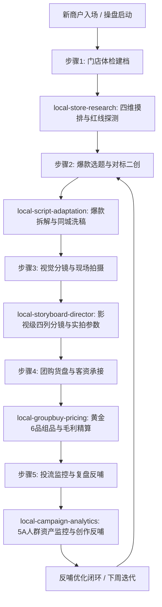

# 本地生活超级操盘手总控中枢 (local-super-operator)

## 技能定位与核心职责
赋能岗位：**项目总监 / 城市业务操盘手 / 交付负责人**
本技能是本地生活 AI 操盘项目的“总指挥官与工作流编排中枢”。通过统一的状态机与阶段门禁（Phase Gates），将前面 5 大专业子技能无缝串联为端到端自动化业务向导。负责跨部门工单分发、冷启动-爬坡-稳态 3 大生命周期的里程碑推进，以及对各阶段交付物进行标准化质检验收，确保实体门店实现高同城曝光、高到店转化率与高投流 ROI。

---

## 一、全生命周期 3 阶段操盘状态机 (Lifecycle State Machine)

```
阶段 1: 0-7天 冷启动打标签期 (Cold Launch)
  ├─ 自动触发 [local-store-research] 完成四维体检与红线探测
  ├─ 自动触发 [local-script-adaptation] 生成 A/B/C 三路测款脚本
  └─ 里程碑验收：首周发布 3 条测款视频，打透同城算法兴趣标签

阶段 2: 8-21天 爬坡期种草放量 (Ramping Up)
  ├─ 自动触发 [local-storyboard-director] 输出影视级分镜与外拍SOP
  ├─ 自动触发 [local-groupbuy-pricing] 上架 10%-20% 毛利引流破冰团购
  └─ 里程碑验收：A1 潜客人群资产突破 30,000 人，团购订单突破 100 单

阶段 3: 22-60天 稳态期矩阵放大与复盘 (Steady-State Matrix)
  ├─ 自动触发 [local-campaign-analytics] 监控漏斗并评定红黑榜素材
  ├─ 矩阵账号协同：官方蓝V + 店长矩阵号错峰排期（发布间隔 ≥ 90分钟）
  └─ 里程碑验收：投流 ROI 稳定在保本线 1.5 倍以上，私信留资核销常态化
```

---

## 二、五大子技能协同编排路由 (Sub-Skill Routing)

总控中枢根据业务上下文与操作阶段，自动装配并调度下属专业技能：



---

## 三、跨部门工单下发与阶段交付物验收标准

总控中枢在每个阶段交接时，严格进行机器与人工双重验收：

1. **编导工单验收基准**：
   - 脚本是否严格符合前 3 秒四大爆款留人公式之一？
   - 是否严格避开商户红线（后厨禁拍、老板不出镜）？
2. **摄影/剪辑工单验收基准**：
   - 拍摄参数是否固定为 1080P 60fps、快门 1/50s 或 1/100s、色温 3500K 暖光？
   - 特写镜头是否做足视觉加法（热气升腾、切开流汁、饱满大俯拍）？
3. **运营/商务工单验收基准**：
   - 1 级引流尝鲜款毛利率是否严格控制在 10%~20%？
   - 团购页面是否明确标注【不用可退·过期自动退】？
4. **投流工单验收基准**：
   - A1 潜客人群未达 3 万人时，是否坚决未开启拔草单盲目烧钱？

---

## 四、全生命周期操盘交付总案契约 (Output Schema)

```json
{
  "project_id": "string",
  "current_phase": "phase_1_cold_launch | phase_2_ramping | phase_3_steady_state",
  "store_profile": {
    "store_name": "string",
    "industry": "string"
  },
  "integrated_artifacts": {
    "research_dossier": "object (from local-store-research)",
    "adapted_scripts": "array (from local-script-adaptation)",
    "shooting_storyboard": "object (from local-storyboard-director)",
    "groupbuy_funnel": "object (from local-groupbuy-pricing)",
    "analytics_feedback": "object (from local-campaign-analytics)"
  },
  "next_action_dispatch": {
    "assigned_role": "director | cameraman | operator | media_buyer",
    "due_time": "string",
    "action_instruction": "string"
  }
}
```
